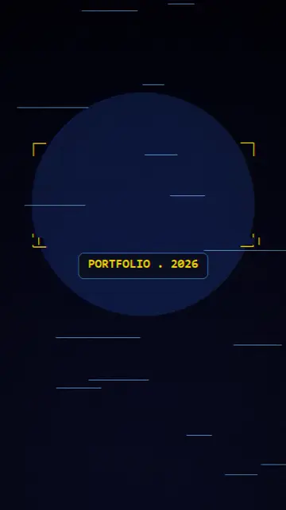

# 🏙️ ARYAN SONSURKAR — Portfolio as a 3D City

**Live:** [arssystem.vercel.app](https://arssystem.vercel.app)

## 🎬 The Reel

▶ **[Watch the full 30s trailer (1080×1920, with sound)](https://github.com/aryan-sonsurkar/Portfolio/releases/download/reel-v1/portfolio-reel.mp4)**

> ### Why should a portfolio feel like a resume… when it can be a WORLD? 🌃
>
> I built my portfolio as a 3D city — 16 buildings, each one a project I shipped:
>
> - 🟡 **MODCODES** — AI student platform (beta)
> - 🟢 **FIXLY** — AI student workspace (live)
> - 🟠 **KOKANAM** — marketplace (live)
> - 🟣 **ArsPDF** — 30 PDF tools, no paywalls
> - 💜 **Client work delivered**
>
> No PDF. No scroll. Just walk in.
> 👉 [arssystem.vercel.app](https://arssystem.vercel.app)

## 🚀 Enter the District

Click **3D District** on the landing page, walk Main Street, enter MODCODES HQ,
talk to Vikram the security guard, teleport to any of the **16 buildings**, and
collect passport stamps 🎟️ as you explore.

- 🕹️ **Controls:** Click to lock mouse · `WASD` move · look around · `E` talk to NPCs · `T` teleport · `Esc` exit
- 🌙 **Atmosphere:** night-look neon district with weather, NPCs, and ambient city audio
- 🧑‍💻 **102 days of building in public** — every building is a real project

## 🛠️ Stack

Three.js · React 19 · Next.js (App Router) · TypeScript · Tailwind · Zustand
